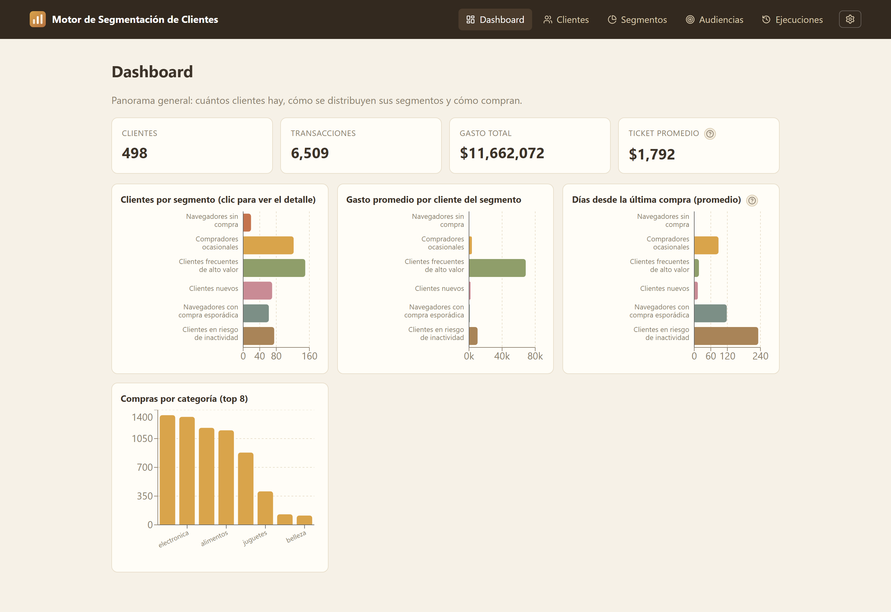
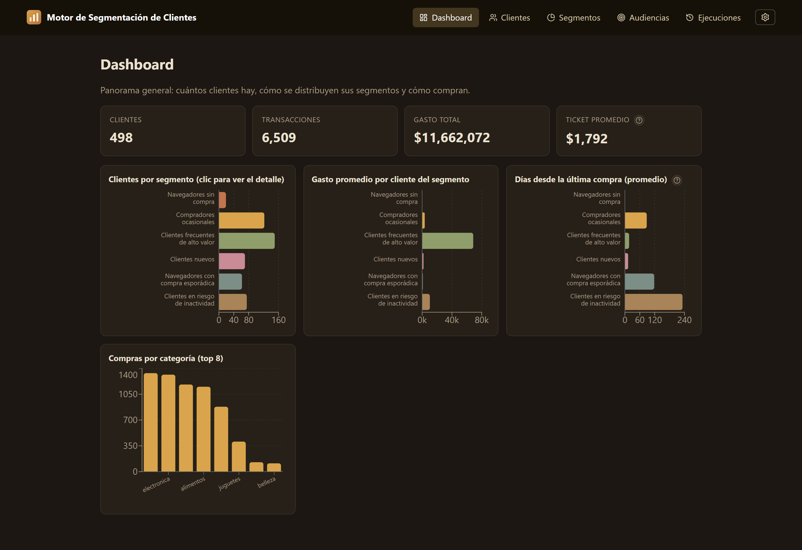
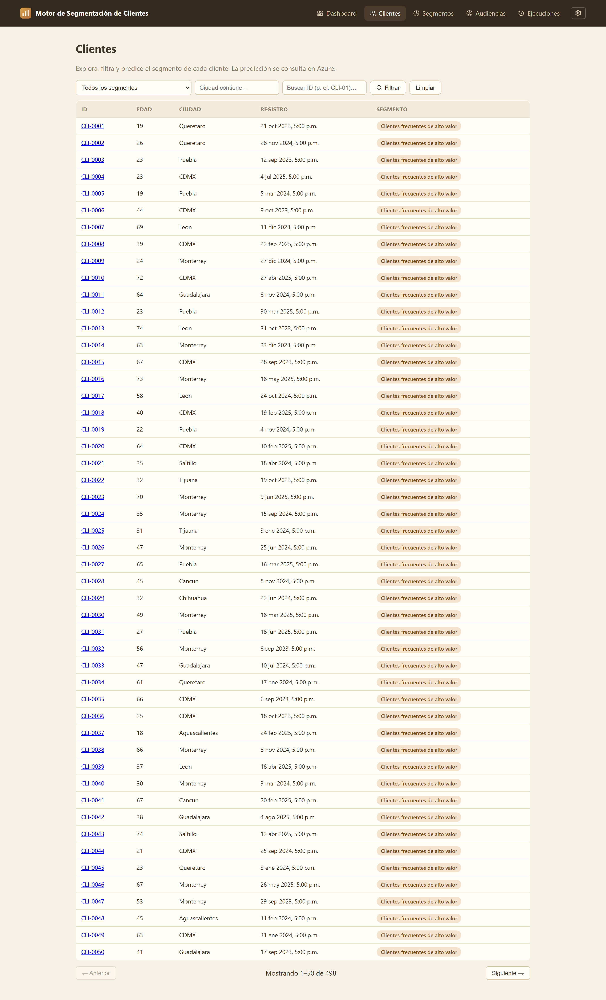
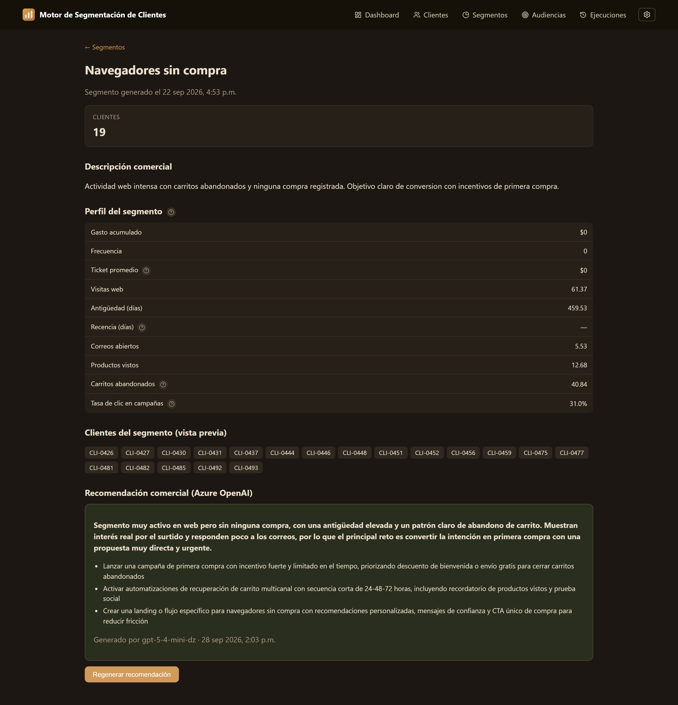
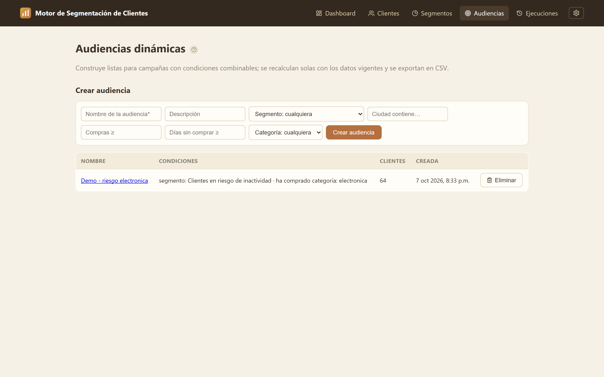

# Motor Inteligente de Segmentación de Clientes

[](https://github.com/Ezumi005/G19X-UTSLRC-AABR-667-ACADEMIC/actions/workflows/ci.yml)

## 1. Propósito del proyecto

Construir una aplicación web que reciba datos de clientes, los normalice, calcule variables útiles, segmente clientes mediante Machine Learning y genere recomendaciones comerciales por segmento mediante Azure OpenAI.

El proyecto se desarrolla para **PluriOne S.A. de C.V. (Develop Talent & Technology)** y se implementará inicialmente con **datos simulados**, porque no se contará con acceso a los sistemas reales de la empresa.

## Capturas

| Dashboard (tema claro) | Dashboard (tema oscuro) |
|---|---|
|  |  |

| Clientes con filtros y predicción | Segmento con recomendación (Azure OpenAI) |
|---|---|
|  |  |



## 2. Decisión de arquitectura principal

**El sistema NO se construye alrededor del CRM simulado.**

El CRM simulado es únicamente una fuente externa de entrada. El núcleo del sistema trabaja con un **modelo interno de datos estable**. Cada fuente externa debe tener un **adaptador** que traduzca su formato al formato interno.

Esto permite reemplazar en el futuro la fuente simulada por HubSpot, Salesforce, Dynamics, una base de datos, archivos CSV/JSON u otra fuente sin modificar el motor de segmentación.

```text
Fuente externa
    |
    v
Adaptador de la fuente
    |
    v
Contrato interno de datos
    |
    v
PostgreSQL / procesamiento / ML / aplicación
```

## 3. Fuente de datos del MVP

Se creará una **API que simule la fuente de datos de un CRM**. Esta API debe comportarse como un sistema externo y entregar datos en un formato propio.

Endpoints propuestos del simulador:

- `GET /crm/customers`
- `GET /crm/transactions`
- `GET /crm/interactions`
- `GET /crm/campaign-events`

La API simulada NO debe devolver directamente las features finales del modelo. Debe entregar datos suficientemente cercanos a una fuente empresarial para que el sistema tenga que integrarlos y transformarlos.

Implementación actual: `crm_simulator/` — generador de dataset con semilla fija (6 perfiles de comportamiento, ~500 clientes, 18 meses de historia) + API FastAPI en el puerto 8001. Su formato externo (`clientId`, `totalAmount` como texto, `productLine`, etc.) es deliberadamente distinto del contrato interno. El perfil real de cada cliente se guarda como ground truth en `data/meta.json` y NO se sirve por la API.

**Fuentes adicionales sin código (asistidas por IA):** la vista **Fuentes** de la web permite subir cualquier CSV y conectarlo al sistema: Azure OpenAI sugiere la entidad y el mapeo de columnas (sinónimos en español/inglés, formatos de fecha diversos), el usuario revisa y confirma, se valida en seco contra el contrato y se sincroniza al pipeline normal con la misma trazabilidad (`DynamicCSVAdapter`, misma interfaz `BaseAdapter`). Los campos disponibles se derivan por introspección del contrato (`src/contracts`), sin duplicación. Las API externas (HubSpot, Salesforce…) siguen integrándose con un adaptador en código.

## 4. Contrato interno de datos

Los adaptadores deben convertir cualquier fuente al siguiente modelo conceptual.

### Customer

- `customer_id`
- `age`
- `city`
- `registered_at`

### Transaction

- `transaction_id`
- `customer_id`
- `purchased_at`
- `amount`
- `category`

### Interaction

- `interaction_id`
- `customer_id`
- `interaction_type`
- `occurred_at`

### CampaignEvent

- `campaign_id`
- `customer_id`
- `event_type`
- `occurred_at`

Los tipos y la obligatoriedad de cada campo están definidos en el **Contrato Interno de Datos V1**, formalizado en `docs/contrato_interno_datos_v1.md` y codificado con Pydantic en `src/contracts/` (prueba: `tests/test_contrato.py`). Los campos opcionales pueden ser nulos. Los cambios al contrato deben versionarse y registrarse en `Bitacora.md`.

## 5. Features para segmentación

A partir del contrato interno se construye una tabla de features por cliente. Como mínimo:

- `recency_days`: días desde la última compra.
- `frequency`: cantidad de compras.
- `monetary`: gasto acumulado.

Features adicionales permitidas:

- `avg_ticket`
- `campaign_click_rate`
- `emails_opened`
- `web_visits`
- `abandoned_carts`
- `favorite_category`
- métricas de engagement derivadas.

**RFM es la base mínima.** No agregar features sin justificar su utilidad y calidad.

Implementación actual: `src/features/rfm.py` — construye desde PostgreSQL la tabla por cliente (498 filas): RFM con fecha de referencia determinista (`max(purchased_at)` del dataset) más features justificadas: `avg_ticket`, `tenure_days`, `web_visits`, `product_views`, `abandoned_carts`, `emails_opened`, `campaign_click_rate` y `favorite_category` (metadato, no entra directo al clustering). `recency_days` es nulo para clientes sin compras; la imputación se decidirá en la etapa de ML. Las features no se persisten: se computan a demanda (CSV de inspección en `data/features_rfm.csv`).

## 6. Machine Learning

- Lenguaje: Python.
- Librerías iniciales: Pandas, NumPy y Scikit-learn.
- Enfoque inicial: clustering.
- Algoritmo inicial: K-Means.
- El modelo se desarrolla y valida primero de forma local.
- Se deben comparar distintas cantidades de clusters y evaluar al menos Silhouette Score e interpretación comercial.
- Los clusters no reciben nombres comerciales hasta analizar sus características reales.

Ejemplo correcto:

`Cluster 2` -> se analiza -> "Clientes frecuentes de alto valor".

No asignar etiquetas comerciales antes de conocer los resultados del modelo.

Implementación actual: `src/ml/clustering.py` — prepara la matriz (imputación de `recency_days` nulo al máximo observado, `log1p` en variables sesgadas, StandardScaler), evalúa k=2..10 con Silhouette/Inertia/Davies-Bouldin bajo una regla pre-declarada (mejor Silhouette, empate ≤0.01 → menor k), entrena K-Means (semilla 42, n_init=10), verifica estabilidad (ARI entre semillas), perfila clusters en unidades originales y valida contra los perfiles reales (`data/meta.json`, solo validación). Features del modelo: `recency_days, frequency, monetary, web_visits, abandoned_carts, campaign_click_rate, tenure_days` (se excluyen `avg_ticket`, `product_views` y `emails_opened` por correlación alta). Artefacto: `models/kmeans_local.pkl` (no versionado). Estado: **k=6, decisión de negocio** (Bitacora.md, 22/09/2026, amparada en PRD §30): Silhouette 0.414 casi idéntico al mejor estadístico 0.430 (k=4), estabilidad 0.993, ARI vs perfiles reales 0.794 (vs 0.659 de k=4); aísla el segmento de riesgo con pureza 100%. La regla estadística se sigue calculando e imprimiendo en cada ejecución para trazabilidad.

Interpretación y persistencia: `src/ml/segmentation.py` asigna **etiquetas comerciales** mediante reglas sobre el perfil de cada cluster (independientes del número de cluster) y guarda cada ejecución en `segmentation_runs`, `segments` (con perfil JSONB) y `customer_segments`. Los choques entre clusters se resuelven de forma determinista: si dos clusters cumplen la misma regla, la etiqueta es del que mejor encierra el concepto (mayor gasto en alto valor, más carritos abandonados en navegadores, etc.) y el resto se reevalúa con reglas de menor prioridad; si varios clusters no cumplen ninguna regla reciben la etiqueta general "Compradores ocasionales" y sus variantes de menor actividad. Etiquetas vigentes: Clientes frecuentes de alto valor · Navegadores sin compra · Compradores ocasionales · Clientes nuevos · Navegadores con compra esporádica · Clientes en riesgo de inactividad (más las variantes de la etiqueta general, "… de baja actividad" y "… de actividad mínima", que solo aparecen si varios clusters no cumplen ninguna regla).

## 6-bis. Cómo se generan los segmentos y las audiencias

### Segmentos: los descubre el modelo (Machine Learning)

Nadie define los grupos: el algoritmo los encuentra a partir del comportamiento.

1. **Datos**: clientes con compras, interacciones y campañas, ya normalizados en PostgreSQL (contrato V1).
2. **Features por cliente** (`src/features/rfm.py`): RFM (hace cuánto compró, cuántas veces, cuánto gastó) + engagement (visitas web, carritos abandonados, tasa de clic) + antigüedad.
3. **Preparación** (`src/ml/clustering.py`): imputación de recency nulo, log1p en variables sesgadas y escalado.
4. **K-Means (k=6)**: agrupa clientes similares entre sí y distintos de los demás; validado con Silhouette, estabilidad y contraste contra el ground truth del simulador.
5. **Etiquetas comerciales** (`src/ml/segmentation.py`): reglas sobre el PERFIL de cada grupo (no sobre su número) asignan "Clientes frecuentes de alto valor", "En riesgo de inactividad", etc.

Se generan cada vez que se ejecuta una segmentación (`POST /segmentation/run` o `.venv\Scripts\python.exe -m src.ml.segmentation`); cada corrida conserva su historial completo (tablas `segmentation_runs`, `segments`, `customer_segments`).

### Audiencias dinámicas: las define el usuario (reglas)

Sin machine learning: son **filtros con condiciones combinables (AND)** definidas por el usuario — segmento, ciudad, frecuencia mínima, días sin compra, categoría comprada — evaluadas con SQL (`queries.audience_members`). La membresia NO se persiste: se **recalcula con los datos vigentes en cada consulta** (RF-19) y se exporta en CSV para campañas (`GET /audiences/{id}/export`).

### Diferencia esencial

| | Segmentos | Audiencias |
|---|---|---|
| ¿Quién decide? | El algoritmo (descubre) | El usuario (define reglas) |
| ¿Para qué? | Entender la cartera (¿qué tipos de cliente tengo?) | Actuar (¿a quién va esta campaña?) |
| ¿Cuándo cambian? | Al ejecutar una nueva segmentación | En cada consulta, con los datos vigentes |

Flujo de negocio completo: **segmentos** (entender) → **audiencias** (lista exacta) → **CSV** (campaña) → **Azure OpenAI** (estrategia sugerida por segmento).

## 7. Azure Machine Learning

Azure Machine Learning se usa DESPUÉS de validar el modelo localmente.

Responsabilidades cumplidas:
- registrar el modelo: **hecho** (`kmeans-local:1` en el workspace `ml-motor-seg-v2`);
- versionarlo y definir su ambiente: **hecho** (`motor-segmentacion-env:1`, mismas versiones del entrenamiento);
- desplegarlo y exponer un endpoint de inferencia: **los endpoints online de Azure ML no están disponibles para este tipo de suscripción** (bloqueo documentado con evidencia en `Bitacora.md`, 23-28/09/2026: 4 regiones, 4 workspaces, proveedores completos, ARM directo con identidad — el plano de inferencia rechaza la suscripción).

**Desviación aprobada (documentada):** la inferencia se sirve en **Azure App Service** (`motor-seg-scoring`, plan F1 gratuito en centralus) con el MISMO artefacto y lógica (`azure/scoring_app/`, autenticación `X-API-Key`). El backend lo consume mediante `src/services/scoring.py` (`POST /customers/{id}/predict`); React nunca lo toca. El contrato de scoring es idéntico al de `azure/score.py` (Azure ML) para poder migrar a un endpoint online si la suscripción lo permite en el futuro.

**Nota operativa — arranque en frío:** el plan gratuito F1 "duerme" la app tras ~20 minutos sin uso; el primer request tras inactividad tarda 10-30 segundos. El diagnóstico (servicio sano, health 0.5s) confirmó que los fallos de predicción venían de eso y no de una avería. Fix implementado: timeout de 90 s + reintento automático en `src/services/scoring.py`.

**Coherencia artefacto remoto ↔ segmentos vigentes (hallazgo de revisión, corregido).** El artefacto servido en Azure NO se reentrena cuando se pulsa "Recalcular segmentos" (que reentrena en local): si los datos cambian (p. ej. tras sincronizar un CSV), el cluster devuelto por Azure puede dejar de corresponder con los segmentos vigentes. Mitigación implementada (visible, no oculta):

- `models/artefacto_desplegado.json` (versionado) declara con qué run/línea de datos se entrenó el artefacto desplegado (hoy: run #4, 498 clientes, línea base del CRM simulado).
- `POST /customers/{id}/predict` responde además `warnings: []`: (a) si hubo una ingesta exitosa después de la última segmentación exitosa (`queries.data_changed_since_segmentation`), avisa "recalcula segmentos"; (b) si el run vigente difiere de la línea base declarada del artefacto (`scoring.artifact_coherence`), avisa que el cluster puede no corresponder. La web muestra ambas advertencias en la predicción.
- `save_artifact` escribe junto al `.pkl` un `models/kmeans_local.json` con el run vigente al exportar, para saber qué copiar al realinear.
- Procedimiento de realineación (documentado en el propio JSON): re-exportar artefacto → actualizar `artefacto_desplegado.json` → redesplegar el App Service → confirmar `/health`.

## 8. Azure OpenAI

Azure OpenAI NO realiza la segmentación.

Su función en este proyecto es recibir un resumen de las características de un segmento y producir:

- descripción comercial;
- recomendaciones de marketing/ventas;
- acciones sugeridas por segmento.

Las recomendaciones son apoyo para decisión humana, no acciones automáticas obligatorias.

## 9. Backend

Tecnología principal: **Python + FastAPI**.

Responsabilidades:

- consumir fuentes externas;
- ejecutar adaptadores;
- validar datos;
- comunicarse con PostgreSQL;
- preparar procesos de segmentación;
- consumir Azure Machine Learning;
- consumir Azure OpenAI;
- exponer la API principal del producto;
- proteger credenciales y secretos.

Endpoints iniciales de la aplicación:

- `POST /ingestion/sync`
- `GET /ingestion/runs` (historial con duración e incidencias)
- `GET /customers` (con filtros `segment`, `city`, `q`)
- `GET /customers/{id}`
- `POST /customers/{id}/predict` (inferencia en Azure)
- `POST /segmentation/run`
- `GET /segmentation/runs` (historial con métricas)
- `GET /segments`
- `GET /segments/{id}`
- `GET /segments/{id}/recommendation`
- `POST /segments/{id}/recommendation`
- `GET/POST/DELETE /audiences[/{id}]` (audiencias dinámicas) + `GET /audiences/{id}/export` (CSV)
- `GET /sources` · `POST /sources/csv/upload` · `POST /sources/csv/suggest` · `POST /sources/csv/validate` · `POST /sources/csv` · `POST /sources/{id}/sync` · `DELETE /sources/{id}` (fuentes CSV con mapeo asistido por IA; `/schema/{entidad}` expone los campos del contrato por introspección)

Los nombres pueden cambiar, pero las responsabilidades deben mantenerse separadas.

Implementación actual: `src/api/` (puerto 8000: `.venv\Scripts\python.exe -m uvicorn src.api.app:app --port 8000`). Routers por dominio (`ingestion`, `customers`, `segments`, `dashboard`, `audiences`, `sources`) más `/health`. `GET /segments` devuelve el último run exitoso; `POST /segments/{id}/recommendation` está implementado con Azure OpenAI (degrada con 501 informativo si no hay credenciales y 502 si el servicio cae). Lecturas centralizadas en `src/persistence/queries.py`. CORS habilitado solo para desarrollo React (localhost:5173/3000). Verificado en vivo: todos los endpoints responden, incluidos los casos de error 404/501/502.

## 10. PostgreSQL

PostgreSQL almacena la representación interna del sistema y sus resultados.

Entidades mínimas esperadas:

- customers
- transactions
- interactions
- campaign_events
- segmentation_runs
- segments
- customer_segments
- recommendations

No guardar el payload externo como si fuera el modelo interno definitivo. Primero debe pasar por su adaptador y validación.

Implementación actual: `src/persistence/schema.sql` — tablas `customers`, `transactions`, `interactions`, `campaign_events` (espejo del contrato V1, con CHECKs de enums), `ingestion_runs`/`ingestion_incidents` (trazabilidad de ingestiones), `segmentation_runs`/`segments`/`customer_segments` (trazabilidad de segmentaciones), `audiences` (audiencias dinámicas PRD §16: condiciones JSONB, membresía recalculada en cada consulta) y `data_sources` (fuentes externas conectadas: entidad, mapeo columna→campo, última sincronización). Sin FKs en las tablas de datos: la integridad referencial corresponde al procesamiento (contrato, sección 2); las tablas de segmentación sí llevan FKs estructurales. Falta `recommendations`… ya existe (Azure OpenAI).

## 11. Frontend

Tecnología: **React** (preferentemente TypeScript/TSX).

Vistas mínimas:

- Dashboard.
- Clientes.
- Segmentos.
- Detalle de segmento.
- Recomendaciones.

React consume únicamente la API del backend. Las claves de Azure y demás secretos nunca deben estar en el frontend.

Implementación actual: `frontend/` — Vite + React 19 + TypeScript + react-router + recharts (gráficas). Vistas: Dashboard (indicadores, 4 gráficas), Clientes (filtros, detalle expandible, botón de predicción Azure y enlace a página propia), Detalle de cliente (RFM, features, segmento, predicción), Segmentos, Detalle de segmento (recomendación), Audiencias (creación con condiciones combinables, listado, miembros y export CSV) y Ejecuciones (runs de segmentación e historial de ingestión). Cliente HTTP centralizado en `src/api.ts`; sin credenciales ni llamadas a servicios externos. Incluye `ErrorBoundary` (errores visibles, nunca pantalla en blanco), glosario con modales informativos (`InfoTip`) y tema claro/oscuro con montos en pesos MXN.

**Nota operativa:** el backend tarda ~20 s en arrancar (carga de pandas/sklearn); si la web muestra error de conexión justo después de levantarlo, espera unos segundos y recarga.

## 12. Orden de desarrollo

1. Definir contrato interno de datos.
2. Generar dataset simulado realista.
3. Crear API simulada del CRM.
4. Crear adaptador del CRM simulado.
5. Validar y guardar datos normalizados en PostgreSQL.
6. Crear pipeline de preparación y features RFM.
7. Crear y validar K-Means localmente.
8. Interpretar clusters.
9. Crear backend principal con FastAPI.
10. Registrar y desplegar modelo en Azure ML.
11. Conectar backend con endpoint de Azure ML.
12. Integrar Azure OpenAI para recomendaciones.
13. Crear React y consumir la API del backend.
14. Agregar seguridad, manejo de errores y pruebas.
15. Documentar y preparar demostración.

Nota: las etapas 10-12 (Azure ML / Azure OpenAI) requieren suscripción de Azure; la etapa 13 (React) se adelantó mientras se obtiene la suscripción (registro en `Bitacora.md`, 22/09/2026).

Estado al 28/09/2026: **etapas 1-14 completadas**. Etapas 10-11 con desviación aprobada (§7). Etapa 15: esta documentación y la guía de demostración (§18).

Estado al 16/10/2026: **MVP cerrado + servicio de fuentes CSV asistidas por IA en producción** (adaptador dinámico introspectado, sugerencia de mapeo con Azure OpenAI, asistente web de 3 pasos y ciclos de vida de fuentes; 10 suites + CI en GitHub Actions con badge).

## 13. Reglas que NO se deben romper

- No acoplar el modelo de ML al formato del CRM simulado.
- No modificar el motor de segmentación para integrar una nueva fuente; crear un nuevo adaptador.
- No usar Azure OpenAI para decidir los clusters.
- No llamar directamente a Azure ML u OpenAI desde React.
- No exponer claves o secretos en el frontend.
- No empezar por Azure ML antes de tener un modelo local funcional.
- No agregar tecnologías secundarias si el camino principal todavía no funciona.
- No asumir datos reales de PluriOne; el proyecto trabaja con datos simulados.

### Control de versiones con Git

Todo el desarrollo debe registrarse progresivamente en Git para generar un historial completo del proyecto:

- Git se inicializa desde el comienzo del desarrollo.
- Se realizan commits después de avances significativos, con mensajes claros y descriptivos.
- No se espera hasta el final para crear el historial.
- No se elimina ni altera el historial de commits existente.
- El repositorio debe quedar preparado para vincularse posteriormente con GitHub (remoto pendiente de configurar).
- Cada avance importante queda reflejado tanto en Git como en `Bitacora.md`.

## 14. Qué debe demostrar el MVP

El MVP debe probar de extremo a extremo que:

1. una fuente CRM simulada puede entregar datos;
2. un adaptador puede traducirlos al contrato interno;
3. los datos pueden validarse y persistirse;
4. Python puede generar features de segmentación;
5. el modelo puede crear clusters útiles;
6. Azure ML puede servir el modelo desplegado;
7. Azure OpenAI puede generar recomendaciones por segmento;
8. FastAPI puede exponer el resultado;
9. React puede visualizarlo.

Estado del MVP (28/09/2026): los 9 puntos se cumplen de extremo a extremo sobre datos simulados y verificados en vivo. El punto 6 se cumple con la desviación documentada en §7 (inferencia servida en Azure App Service con el mismo artefacto; modelo registrado y versionado en Azure ML). Las recomendaciones del punto 7 están generadas para los 6 segmentos y visibles en el frontend.

## 15. Adaptación futura a un CRM real

Para integrar un CRM real:

1. estudiar su API o mecanismo de acceso;
2. crear un conector/adaptador para esa fuente;
3. mapear sus campos al contrato interno;
4. validar la salida del adaptador;
5. mantener sin cambios el resto del sistema siempre que el contrato interno no cambie.

**Principio rector:** las fuentes externas cambian; el núcleo del sistema debe permanecer estable.

## 16. Estructura del repositorio

```text
MSIA/                          # raíz del proyecto (repositorio Git)
├── README.md                  # este documento: mapa del proyecto
├── Bitacora.md                # historial cronológico del desarrollo
├── PRD_*.pdf / MVP_*.pdf      # documentos originales de la universidad (entregables externos, NO se versionan; su texto sí vive en docs/)
├── .gitignore
├── requirements.txt           # dependencias Python del proyecto
├── docs/                      # documentación técnica
│   ├── contrato_interno_datos_v1.md                  # contrato interno V1 (documento)
│   ├── PRD_..._v1.1.md / MVP_..._v1.1.md             # texto de referencia HISTÓRICO (superseded)
│   ├── PRD_..._v2.0_FINAL.md / MVP_..._v2.0_FINAL.md # versión VIGENTE (cierre con evidencia)
│   └── img/                                           # capturas de la web (dashboard, segmentos, audiencias)
├── src/                       # núcleo de la aplicación
│   ├── contracts/             # contrato interno codificado (Pydantic; fuente única de verdad)
│   ├── adapters/              # adaptadores: fuente externa → contrato interno
│   │   ├── base.py            # BaseAdapter (ABC) + AdapterResult/AdapterReport/Incident
│   │   ├── simulated_crm_adapter.py   # SimulatedCRMAdapter (API en puerto 8001)
│   │   └── csv_adapter.py     # DynamicCSVAdapter (CSV subido desde la web, mapeo dinámico)
│   ├── persistence/           # PostgreSQL: esquema, repositorio, ingesta y consultas
│   │   ├── schema.sql         # esquema interno (espejo del contrato V1 + segmentación)
│   │   ├── db.py              # conexión vía DATABASE_URL (.env)
│   │   ├── repository.py      # upserts idempotentes
│   │   ├── queries.py         # consultas de lectura para la API
│   │   ├── init_db.py         # crea la base y aplica el esquema
│   │   └── ingest.py          # sincronización: simulador → adaptador → PostgreSQL
│   ├── features/              # ingeniería de características
│   │   └── rfm.py             # tabla RFM + engagement por cliente (desde PostgreSQL)
│   ├── ml/                    # motor de segmentación
│   │   ├── clustering.py      # preparación, evaluación de k, entrenamiento y validación
│   │   └── segmentation.py    # etiquetas comerciales + persistencia de ejecuciones
│   ├── services/              # servicios que consumen plataformas Azure
│   │   ├── recommendations.py # Azure OpenAI (gpt-5.4-mini DataZone)
│   │   ├── scoring.py         # cliente del scoring en Azure App Service
│   │   └── mapping_suggest.py # sugerencia de mapeo CSV → contrato (Azure OpenAI)
│   └── api/                   # API principal FastAPI (puerto 8000)
│       ├── app.py             # create_app + /health + CORS de desarrollo
│       └── routes/            # routers: ingestion, customers, segments, dashboard, audiences, sources
├── tests/                     # 10 suites de pruebas (una por módulo: contrato, adaptador, features, clustering, segmentación, recomendaciones, scoring, API, audiencias, fuentes)
├── crm_simulator/             # API CRM simulada: fuente externa independiente
│   ├── generate_data.py       # generador del dataset (semilla fija → reproducible)
│   └── app.py                 # API FastAPI con formato externo propio (puerto 8001)
├── azure/                     # despliegue en Azure
│   ├── scoring_app/           # servicio de inferencia (App Service, F1, centralus)
│   ├── score.py               # scoring equivalente para endpoint online de Azure ML
│   ├── conda_env.yml / environment.yml  # entorno registrado en Azure ML
│   └── deploy_endpoint.py     # despliegue por SDK (endpoint online)
├── data/                      # dataset generado *.json + meta.json/ground truth (no versionado)
├── models/                    # artefactos de modelos, p.ej. kmeans_local.pkl (no versionado; excepción versionada: artefacto_desplegado.json con la línea de datos del modelo remoto)
├── frontend/                  # React 19 + TypeScript + Vite (puerto 5173)
│   └── src/
│       ├── api.ts             # cliente HTTP de la API del backend
│       ├── types.ts           # tipos de las respuestas
│       └── pages/             # Dashboard, Customers, CustomerDetail, Segments,
│                                SegmentDetail, Audiences, Sources, Runs
└── .venv/                     # entorno virtual local (no versionado)
```

Versionado de la documentación: la versión **vigente** de PRD y MVP en `docs/` es la **v2.0 FINAL** (cierre con evidencia de cada requisito); las v1.1 se conservan como histórico. Los PDF originales son entregables externos de la universidad y no se versionan en el repositorio (`.gitignore`).

## 17. Preparación del entorno de desarrollo

Verificado (10/09/2026): Git 2.55, Python 3.14.2, Node.js 24 + npm 11, PostgreSQL 18.6 (servicio `postgresql-x64-18`), winget.

```powershell
# desde la raíz del proyecto
python -m venv .venv
.venv\Scripts\python.exe -m pip install -r requirements.txt
.venv\Scripts\python.exe -m tests.test_contrato     # prueba del contrato interno
.venv\Scripts\python.exe -m tests.test_adapter      # prueba del adaptador (unitaria, sin API encendida)
```

**API CRM simulada** (fuente externa, puerto 8001):

```powershell
.venv\Scripts\python.exe -m crm_simulator.generate_data          # genera data/*.json (semilla fija, reproducible)
.venv\Scripts\python.exe -m uvicorn crm_simulator.app:app --port 8001
# Documentación interactiva: http://127.0.0.1:8001/docs
# Backend principal (puerto 8000)
.venv\Scripts\python.exe -m uvicorn src.api.app:app --port 8000
# Docs interactivas: http://127.0.0.1:8000/docs  (POST /ingestion/sync requiere el simulador en 8001)
```

El backend principal usa el puerto 8000. Las credenciales de PostgreSQL y de Azure viven en un `.env` local, nunca en el repositorio.

**Frontend React** (puerto 5173; requiere el backend en 8000):

```powershell
cd frontend
npm install        # solo la primera vez
npm run dev        # abre http://localhost:5173
```

**PostgreSQL y pipeline analítico** (requiere `.env` con `DATABASE_URL`; ver `.env.example`):

```powershell
.venv\Scripts\python.exe -m src.persistence.init_db    # crea la base motor_segmentacion y aplica el esquema (idempotente)
.venv\Scripts\python.exe -m src.persistence.ingest     # ingesta: simulador → adaptador → PostgreSQL (requiere simulador en 8001)
.venv\Scripts\python.exe -m src.features.rfm           # features RFM (escribe data/features_rfm.csv)
.venv\Scripts\python.exe -m src.ml.clustering          # evaluación de k + entrenamiento (escribe models/kmeans_local.pkl)
.venv\Scripts\python.exe -m src.ml.segmentation        # segmentación persistida (k=6, etiquetas comerciales)
```

**Pruebas (10 suites):** ejecutar cada módulo `tests/test_*.py`, p. ej. `.venv\Scripts\python.exe -m tests.test_api` o `tests.test_sources` (fuentes CSV con mock de sugerencia IA y degradación 503).

## 18. Guía de demostración (MVP completo)

**Primera vez (desde cero):**

```powershell
python -m venv .venv
.venv\Scripts\python.exe -m pip install -r requirements.txt
# copiar .env.example como .env y completar credenciales (PostgreSQL, Azure OpenAI, scoring)
.venv\Scripts\python.exe -m crm_simulator.generate_data       # dataset simulado (semilla fija)
.venv\Scripts\python.exe -m src.persistence.init_db           # base + esquema (idempotente)
.venv\Scripts\python.exe -m uvicorn crm_simulator.app:app --port 8001   # simulador (terminal 1)
.venv\Scripts\python.exe -m src.persistence.ingest            # ingesta completa (terminal 2)
.venv\Scripts\python.exe -m src.ml.segmentation               # segmentación con etiquetas
.venv\Scripts\python.exe -m uvicorn src.api.app:app --port 8000        # backend (terminal 2)
cd frontend; npm install; npm run dev                         # frontend (terminal 3)
```

**Demo diaria (todo inicializado):** levantar simulador + backend + frontend, y recorrer:
1. **Dashboard**: indicadores y gráficas (distribución, gasto por segmento, recencia, categorías).
2. **Clientes**: filtros por segmento/ciudad/ID; en el detalle expandible, botón **"Predecir segmento (Azure)"**; el ID lleva a la página del cliente (RFM + features + predicción).
3. **Segmentos**: 6 grupos con etiquetas comerciales; en el detalle, perfil medio y recomendación (Azure OpenAI).
4. **Audiencias**: crear una con condiciones combinables (p. ej. "en riesgo" + categoría electrónica) y exportar CSV.
5. **Fuentes**: subir un CSV de prueba con columnas en español crudo → la IA sugiere el mapeo → confirmar → sincronizar (demostración de adaptabilidad sin código). Archivo de demostración listo en `demos/ventas_tienda_fisica.csv` (9 filas de ventas con columnas crudas: `folio, id_cliente, fecha_compra, importe, rubro, producto`; la IA sugiere entidad `transactions` al 98% y el dry-run muestra 6 válidas + 3 incidencias con su motivo, ideal para explicar la validación).
6. **Ejecuciones**: historial de runs de segmentación (métricas) e ingestión (duraciones, conteos, incidencias).

**Recursos Azure activos:** `openai-motor-seg` (Azure OpenAI, gpt-5.4-mini DataZone), `ml-motor-seg-v2` (registro/versionado del modelo) y `motor-seg-scoring` + plan F1 (servicio de scoring).

## 19. Autenticación y seguridad (decisión documentada)

**Estado actual:** la API y la interfaz del MVP **no exigen inicio de sesión**. Es una decisión deliberada, no una omisión:

1. **El PRD lo condiciona** (§25): la autenticación aplica *"cuando el entorno lo requiera"* — con roles (administrador, analista, marketing, ventas) y Microsoft Entra ID para entornos empresariales.
2. **El destino del MVP es una demostración académica local**: un solo usuario (el presentador) opera la aplicación en `localhost`; un login añadiría fricción sin aportar valor en ese contexto.
3. **Lo que SÍ está protegido desde el día uno:** credenciales exclusivamente en el `.env` local (nunca en el repo ni en el frontend), el servicio de scoring en Azure con autenticación por `X-API-Key`, CORS restringido a los orígenes de desarrollo, y validación de entradas en todos los endpoints.

**Si el entorno llegara a requerirlo** (uso multiusuario, demo externa, despliegue público), el camino definido es: login simple con API key o JWT (~1 día) y, en su evolución, roles por perfil (~2 días) según la matriz del PRD. La arquitectura por capas no requiere cambios: sería un middleware más del backend.

## 20. Docker (opcional, documentado)

Para levantar todo el stack con un comando (requiere Docker Desktop instalado):

```powershell
docker compose up --build
# frontend: http://localhost:5173 · backend: http://localhost:8000 · simulador: 8001 · postgres: 5432
```

Archivos: `docker-compose.yml` (postgres 18 + simulador + backend + frontend nginx) y `Dockerfile` por servicio. Nota: verificado por diseño y CI; la máquina de desarrollo del proyecto no tiene Docker Desktop, por lo que la ejecución local de estos archivos queda a discreción del usuario.

---

## 21. Donde se usa Inteligencia Artificial (mapa completo)

El sistema usa IA exactamente en **tres puntos**, con fronteras de seguridad definidas (nada del frontend llama a Azure ni expone llaves; toda llamada sale desde el backend):

1. **Recomendaciones comerciales por segmento (IA generativa - Azure OpenAI).**
   - En `src/services/recommendations.py` y endpoint `POST /segments/{id}/recommendation`.
   - Entrada: agregados reales del segmento (perfil JSONB). Salida: estrategia comercial en JSON, persistida y regenerable desde la web.
   - Guardas: temperature 0.4 (redacción comercial con margen acotado; el mapeo CSV usa 0 determinista), timeout, parseo tolerante y degradacion informativa si no esta configurada. Regla inviolable: **la IA nunca decide los clusters ni las etiquetas**.

2. **Sugerencia de mapeo para fuentes CSV (IA generativa - Azure OpenAI).**
   - En `src/services/mapping_suggest.py` y endpoint `POST /sources/csv/suggest` (vista Fuentes de la web: boton/badge "Sugerido por IA").
   - Recibe el esquema introspectado del contrato + columnas + filas de muestra y propone entidad y mapping (sinonimos EN/ES, formatos de fecha, confianza). **El humano confirmara**, la validacion en seco contra el contrato y luego sincroniza; sin IA configurada, degrada con 503 y el asistente manual queda operativo.
   - Este servicio es el diferenciador del cierre: adaptar una fuente nueva **sin escribir codigo**.

3. **Modelo de aprendizaje automatico (no generativo).**
   - K-Means k=6 con semilla fija (`src/ml/clustering.py`) para segmentacion, cuyo artefacto se sirve en Azure App Service para las predicciones por cliente (`src/services/scoring.py`). Es machine learning, no un modelo de lenguaje.

**No hay IA en:** las etiquetas comerciales (reglas humanas sobre perfiles), las audiencias, el dashboard, las validaciones del contrato ni la ingesta. El simulador de CRM tampoco usa IA (generador deterministico con semilla).

---

## 22. Manual de arranque completo (desde este repositorio)

Instrucciones paso a paso para levantar TODO el proyecto desde cero en una computadora nueva, usando solo este repositorio.

**Prerequisitos:** Windows (o Linux/macOS ajustando comandos), Git, Python 3.12+ (proyecto en 3.14), Node.js 20+, PostgreSQL 16+ (proyecto en 18.6). Sin Azure configurado el sistema arranca en modo degradado (sin recomendaciones ni predicciones), util para probar el motor y la web.

```powershell
# 1) Clonar
git clone https://github.com/Ezumi005/G19X-UTSLRC-AABR-667-ACADEMIC.git MotorSeg
cd MotorSeg

# 2) Entorno Python + dependencias
python -m venv .venv
.\.venv\Scripts\activate
pip install -r requirements.txt

# 3) Variables de entorno
copy .env.example .env    # editar: DATABASE_URL (+ AZURE_SCORING_* / AZURE_OPENAI_* si aplica)

# 4) Esquema de base de datos
.\.venv\Scripts\python.exe -m src.persistence.init_db

# 5) CRM simulado (fuente externa; dejar corriendo)
.\.venv\Scripts\python.exe -m uvicorn crm_simulator.app:app --port 8001

# 6) Primera ingesta + primera segmentacion
.\.venv\Scripts\python.exe -m src.persistence.ingest
.\.venv\Scripts\python.exe -m src.ml.segmentation

# 7) Backend principal (arranque ~20 s por la carga de pandas/sklearn)
.\.venv\Scripts\python.exe -m uvicorn src.api.app:app --port 8000

# 8) Frontend
cd frontend
npm install
npm run dev               # http://localhost:5173
```

**Verificacion:**
- http://127.0.0.1:8000/health -> {"status": "ok", ...} (o degradado solo por falta de Azure).
- http://localhost:5173 -> el dashboard muestra 498 clientes, 6 segmentos y KPIs.
- Recorrido completo de demo: seccion 18.

**Sin datos nuevos:** el paso 6 crea los ~498 clientes y las tablas de segmentacion de demostracion a partir del simulador (el paso 5 debe estar corriendo). Repetir ingesta/segmentacion es idempotente y queda trazado en las vistas de Ejecuciones.

**Pruebas (opcional pero recomendado):**
```powershell
.\.venv\Scripts\python.exe -m tests.test_contrato    # sintaxis por suite: python -m tests.test_<modulo> (10 modulos)
.\.venv\Scripts\python.exe -m ruff check src tests crm_simulator azure
cd frontend; npm run build
```

**Docker (alternativa todo-en-uno):** `docker compose up --build` (seccion 20; requiere Docker Desktop).

**CI:** cada push ejecuta en GitHub Actions: PostgreSQL-servicio + esquema + simulador + ingesta + segmentacion + las 10 suites + ruff + build del frontend (badge al inicio de este documento).

---

## 23. Arranque en un clic (scripts del proyecto)

Para operar el proyecto SIN recordar comandos, la raíz del repositorio incluye tres scripts `.bat` de Windows (doble clic):

| Script | Qué hace | Cuándo usarlo |
|---|---|---|
| `instalar_proyecto.bat` | Crea `.venv`, instala dependencias (Python + frontend), crea `.env` desde plantilla, genera el dataset del simulador y aplica el esquema de PostgreSQL | Solo la primera vez (o al cambiar de máquina) |
| `cargar_datos.bat` | Ingesta del simulador + segmentación inicial | Primera vez, y cuando quieras refrescar datos |
| `levantar_proyecto.bat` | Levanta TODO en ventanas separadas: simulador (8001), backend (8000, ~20 s) y frontend (5173), y abre el navegador en `http://localhost:5173` | Todos los días |

**Detener el proyecto:** cierra las 3 ventanas negras que abre el script (o Ctrl+C en ellas).

El paso a paso con comandos individuales (Linux/macOS incluido) sigue disponible en la sección 22 y en `manuales/Guia_de_Instalacion.md`.

---

## 24. Estado final del proyecto (MVP v2.0)

**MVP declarado cerrado el 16/10/2026 tras la revision integral de pruebas** (10 suites + ruff + build del frontend + CI en verde + E2E en vivo de API, IA real y las 7 paginas web con Playwright). Documentos final de referencia en `docs/`:

- `MVP_Motor_Inteligente_Segmentacion_Clientes_v2.0_FINAL.md` — alcance final, arquitectura, arranque e historial de versiones.
- `PRD_Motor_Inteligente_Segmentacion_Clientes_v2.0_FINAL.md` — estado de los RF/RNF, desviaciones aprobadas y mapa de IA.
- Los PDF y extractos v1.1 originales permanecen inalterados (los nuevos documentos se limitan a actualizar su estado).

---

## 25. Modo sin Azure (100% local)

Los servicios de Azure (OpenAI y scoring en App Service) pertenecen a la cuenta del autor y **no son necesarios para instalar, operar ni evaluar el proyecto**: toda la degradación está implementada y documentada (tabla de códigos en `manuales/Manual_Tecnico.md`).

Con un `.env` que SOLO tenga `DATABASE_URL` (la plantilla `.env.example` sirve tal cual):

| Funcionalidad | Comportamiento sin Azure |
|---|---|
| Ingesta (CRM simulado, CSV), segmentación K-Means, etiquetas | **100% operativas** (el motor es local) |
| Dashboard, Clientes, Segmentos, Audiencias, Ejecuciones, Fuentes | **100% operativas** |
| Predicción por cliente (`POST /customers/{id}/predict`) | `501` informativo: "Servicio de scoring en Azure no configurado" |
| Recomendación por segmento (`POST /segments/{id}/recommendation`) | `501` informativo (sin `AZURE_OPENAI_*`) |
| Sugerencia de mapeo CSV (`POST /sources/csv/suggest`) | `503`: "IA no disponible" — el asistente **manual** de 3 pasos queda plenamente operativo |

Es decir: sin Azure el proyecto pierde exactamente las tres asistencias de IA (mapa en §21) y conserva todo el recorrido de datos → segmentos → audiencias → campañas. Las 10 suites de pruebas corren igual en CI (la IA se prueba con mocks; ver `tests/test_recommendations.py` y `tests/test_sources.py`).
